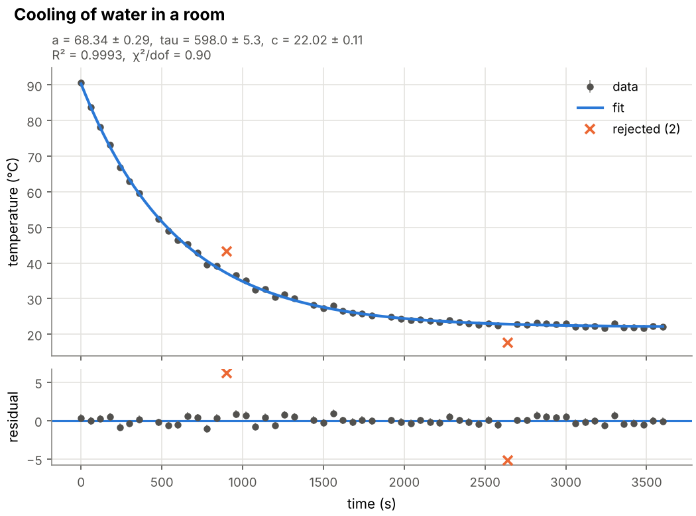
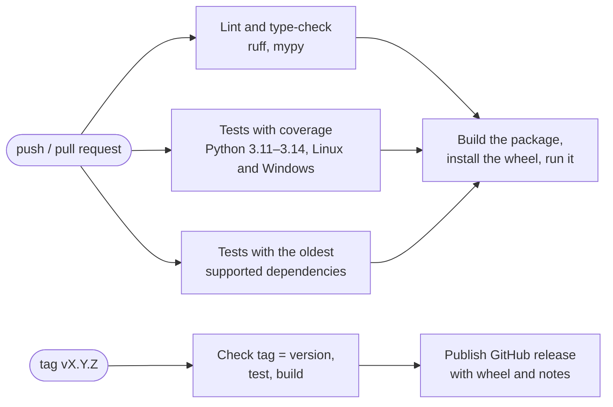

# labcurve

[](https://github.com/KuanshpekZ/labcurve/actions/workflows/ci.yml)
[](https://github.com/KuanshpekZ/labcurve/actions/workflows/release.yml)
[](pyproject.toml)
[](LICENSE)
[](https://docs.astral.sh/ruff/)

**labcurve** is a small command-line tool and Python library that turns a CSV
file of experimental measurements into a cleaned data set, descriptive
statistics, a fitted model with parameter uncertainties, and a figure that is
ready for a lab report.

It covers the routine that follows almost every simple experiment — *read the
logger file, throw away broken rows, fit the expected law, plot it* — and makes
that routine repeatable: one command, no manual editing of the data, and a
report that records exactly what was done.



*Output of the quick-start command below: the example data, the fitted
exponential, two automatically rejected outliers and the residuals.*

## Contents

- [Features](#features)
- [Installation](#installation)
- [Quick start](#quick-start)
- [Command-line reference](#command-line-reference)
- [Python API](#python-api)
- [Methods](#methods)
- [Reproducibility](#reproducibility)
- [Technology choices](#technology-choices)
- [Project structure](#project-structure)
- [Development workflow](#development-workflow)
- [Continuous integration and delivery](#continuous-integration-and-delivery)
- [Testing](#testing)
- [Limitations and roadmap](#limitations-and-roadmap)
- [Citing](#citing)
- [License](#license)

## Features

- **Tolerant CSV reader** — comment lines (`#`), custom delimiters and decimal
  commas (`1,5`) are supported, so files exported by loggers and spreadsheets
  can be used as they are.
- **Transparent cleaning** — rows with missing, non-numeric or duplicated
  values are removed and *counted*; no value is ever changed or imputed.
- **Descriptive statistics** — mean, standard deviation, standard error,
  median, range and a Student's t confidence interval of the mean.
- **Curve fitting** — weighted non-linear least squares with parameter
  uncertainties, R², RMSE and reduced χ².
- **Robust outlier rejection** — optional, iterative, based on the modified
  z-score; rejected points stay visible in the figure and in the output data.
- **Figure and machine-readable report** — a PNG with data, fit and residuals,
  plus a JSON report with all numbers, the checksum of the input file and the
  versions of the libraries used.

Available models (`labcurve models`):

| Name          | Formula                     | Typical use                                     |
|---------------|-----------------------------|-------------------------------------------------|
| `linear`      | `y = a * x + b`             | calibration curves, Hooke's law, Ohm's law      |
| `exponential` | `y = a * exp(-x / tau) + c` | cooling, capacitor discharge, radioactive decay |
| `power`       | `y = a * x^b`               | pendulum period, scaling laws (requires x > 0)  |

## Installation

labcurve needs Python 3.11 or newer.

```bash
pip install git+https://github.com/KuanshpekZ/labcurve.git
```

A wheel and a source archive are also attached to every
[release](https://github.com/KuanshpekZ/labcurve/releases).

For development, clone the repository and install it in editable mode together
with the development tools:

```bash
git clone https://github.com/KuanshpekZ/labcurve.git
cd labcurve
python -m venv .venv
source .venv/bin/activate        # Windows: .venv\Scripts\activate
python -m pip install -e ".[dev]"
```

## Quick start

The repository ships a small example data set, `examples/cooling.csv`: the
temperature of a cup of water cooling in a room, sampled once per minute. It is
**synthetic** (generated by `examples/make_cooling_data.py` with a fixed random
seed) and deliberately contains the defects of a real logger file: two missing
values, a text entry, a duplicated row and two outliers.

```bash
labcurve analyze examples/cooling.csv \
    -x time_s -y temp_c --yerr temp_err_c \
    --model exponential --reject-outliers \
    --xlabel "time (s)" --ylabel "temperature (°C)" \
    --title "Cooling of water in a room"
```

```text
input      examples/cooling.csv
rows       62 read, 58 kept (2 missing, 1 not numeric, 0 invalid uncertainty, 1 duplicate)
model      exponential: y = a * exp(-x / tau) + c
outliers   2 rejected (modified z-score > 3.5)
  a        68.34 +/- 0.29
  tau      598.0 +/- 5.3
  c        22.02 +/- 0.11
R^2        0.99928
RMSE       0.4624
chi2/dof   0.904
written    results/fit.png, results/report.json, results/cleaned.csv
```

The data were generated with `a = 68`, `tau = 600` and `c = 22`; all three
values are recovered to within 1.2 standard uncertainties. Without
`--reject-outliers` the two bad points pull the result to `tau = 615.3 ± 5.3`,
almost three standard uncertainties away from the true value, and the reduced
χ² rises from 0.90 to 5.4 — a clear sign that the model no longer describes
the data.

Three files are written to the output folder (`results/` by default):

| File          | Content                                                                             |
|---------------|-------------------------------------------------------------------------------------|
| `fit.png`     | data, fitted curve and residuals (the figure above)                                 |
| `report.json` | cleaning counts, statistics, fit results, input checksum, options, library versions |
| `cleaned.csv` | the numeric data that were analysed, with a `rejected` column marking outliers      |

## Command-line reference

```text
labcurve analyze INPUT -x COLUMN -y COLUMN [options]
labcurve models
labcurve --version
```

| Option                          | Meaning                                                           | Default       |
|---------------------------------|-------------------------------------------------------------------|---------------|
| `-x`, `--x COLUMN`              | column with the independent variable (required)                   |               |
| `-y`, `--y COLUMN`              | column with the dependent variable (required)                     |               |
| `--yerr COLUMN`                 | column with the standard uncertainty of `y`; weights the fit      | unweighted    |
| `-m`, `--model NAME`            | model to fit                                                      | `linear`      |
| `--reject-outliers [THRESHOLD]` | reject points whose modified z-score exceeds `THRESHOLD`          | off; `3.5`    |
| `-o`, `--out-dir DIR`           | folder for the output files                                       | `results`     |
| `--delimiter CHAR`              | field separator of the CSV file                                   | `,`           |
| `--decimal CHAR`                | decimal separator of the CSV file                                 | `.`           |
| `--xlabel`, `--ylabel TEXT`     | axis labels                                                       | column names  |
| `--title TEXT`                  | figure title                                                      | model formula |
| `--dpi N`                       | resolution of the figure                                          | `150`         |

Exit codes: `0` success, `1` problem with the data or the fit (the message is
printed to standard error), `2` invalid command-line usage.

A file exported from a spreadsheet with a European locale can be read with:

```bash
labcurve analyze data.csv -x t -y U --delimiter ";" --decimal ","
```

## Python API

Every step of the command-line tool is an ordinary function:

```python
from labcurve import (
    clean_measurements,
    fit_curve,
    load_measurements,
    plot_fit,
    save_figure,
    summarize,
)

raw = load_measurements("examples/cooling.csv", x="time_s", y="temp_c", yerr="temp_err_c")
data, cleaning = clean_measurements(raw, x="time_s", y="temp_c", yerr="temp_err_c")
print(cleaning)  # how many rows each cleaning rule removed

print(summarize(data["temp_c"]))

fit = fit_curve(
    data["time_s"],
    data["temp_c"],
    model="exponential",
    yerr=data["temp_err_c"],
    outlier_threshold=3.5,
)
print(dict(zip(fit.parameters, fit.values)))  # best-fit parameters
print(fit.errors, fit.r_squared, fit.reduced_chi2)
print(fit.predict([0, 600, 1200]))  # evaluate the fitted curve

figure = plot_fit(
    data["time_s"],
    data["temp_c"],
    fit,
    yerr=data["temp_err_c"],
    xlabel="time (s)",
    ylabel="temperature (°C)",
)
save_figure(figure, "cooling.pdf")  # format follows the extension
```

All public functions have type hints and NumPy-style docstrings
(`help(labcurve.fit_curve)`). Errors caused by the data raise `DataError`,
failed fits raise `FitError`; both derive from `LabcurveError`.

## Methods

**Cleaning.** A row is removed if, in this order, it (1) has a missing value
(empty cell or a marker such as `NA`, `n/a`, `-`), (2) contains text that is
not a finite number, (3) has an uncertainty that is not strictly positive, or
(4) exactly repeats an earlier row. Each row is counted under the first rule it
violates, so the counts in the report add up to the number of rows read.

**Statistics.** The standard deviation is the sample estimate (n − 1 in the
denominator). The confidence interval of the mean is
`mean ± t(1 − α/2, n − 1) · s / √n` with Student's t distribution.

**Fitting.** Parameters are estimated by non-linear least squares with the
Levenberg–Marquardt algorithm (`scipy.optimize.curve_fit`). Starting values are
derived from the data, so none have to be supplied. If uncertainties are given
they are used as weights and treated as absolute, which makes the parameter
uncertainties and the reduced χ² meaningful; otherwise the parameter
uncertainties are scaled by the scatter of the residuals. R² and RMSE are
computed from the unweighted residuals of the points used in the fit.

**Outlier rejection.** The modified z-score of a residual *r* is
`M = 0.6745 · (r − median) / MAD`, where MAD is the median absolute deviation.
Unlike the mean and the standard deviation, the median and the MAD are barely
affected by the outliers themselves. Points with `|M| > 3.5` (the cut-off
recommended by Iglewicz and Hoaglin) are excluded and the fit is repeated until
the selection no longer changes. Rejection is **off by default**: discarding
measurements is a scientific decision that should be made explicitly and
reported.

References:

- B. Iglewicz and D. C. Hoaglin, *How to Detect and Handle Outliers*, ASQC
  Quality Press, 1993.
- P. Virtanen et al., "SciPy 1.0: fundamental algorithms for scientific
  computing in Python", *Nature Methods* 17, 261–272 (2020).

## Reproducibility

- The analysis is **deterministic**: the same input file and options always
  give the same numbers.
- `report.json` stores the SHA-256 checksum of the input file, the options and
  the versions of Python, NumPy, pandas, SciPy and Matplotlib, so a result can
  be traced back to the exact data and software that produced it.
- The example data are generated by a script with a **fixed random seed** and
  can be regenerated bit for bit with `python examples/make_cooling_data.py`.
- The minimum versions of all dependencies are declared in `pyproject.toml`
  and are **tested in CI**, together with the newest versions.
- Numerical tests compare against known analytical results with explicit
  tolerances instead of exact floating-point equality.

## Technology choices

| Area                | Choice                               | Alternatives considered         | Why this choice                                                                                                                                                                                                                         |
|---------------------|--------------------------------------|---------------------------------|-----------------------------------------------------------------------------------------------------------------------------------------------------------------------------------------------------------------------------------------|
| Language            | **Python ≥ 3.11**                    | R, MATLAB, Julia                | The most widely used language in scientific computing, free and open source (a MATLAB licence would restrict who can reproduce the results), readable for non-programmers. 3.11 is the minimum because 3.10 reaches end of life in October 2026. |
| Numerical arrays    | **NumPy**                            | plain Python lists              | Vectorised arithmetic on whole columns is shorter, faster and less error-prone than loops; NumPy arrays are the common data type of the whole scientific stack.                                                                          |
| Reading tables      | **pandas**                           | `csv` module, Polars            | Handles the messy parts of real CSV files (quoting, comments, separators, short rows) and converts text to numbers column by column. Polars is faster, but speed is irrelevant for lab-sized files and pandas is far more widely known. |
| Fitting, statistics | **SciPy**                            | lmfit, statsmodels, own code    | `curve_fit` wraps the long-established MINPACK Levenberg–Marquardt code and returns the covariance matrix needed for uncertainties. Numerical optimisers are easy to get subtly wrong, so a well-tested implementation is preferred.     |
| Plotting            | **Matplotlib** (object-oriented API) | Plotly, seaborn                 | Static, publication-quality output in PNG, PDF and SVG. The Agg backend needs no display, so figures can be produced on CI servers and clusters.                                                                                        |
| Command line        | **argparse**                         | click, Typer                    | Part of the standard library: no extra dependency for a tool with two commands.                                                                                                                                                         |
| Packaging           | **pyproject.toml**, Hatchling, `src/` layout | `setup.py`, Poetry      | The standard, declarative way to describe a Python package (PEP 621). The `src/` layout guarantees that tests run against the installed package rather than the working folder.                                                         |
| Testing             | **pytest**, pytest-cov               | `unittest`                      | Concise tests, fixtures, parametrisation and `pytest.approx` for floating-point comparison; coverage measurement with a minimum enforced in CI.                                                                                         |
| Linting, formatting | **Ruff**                             | flake8 + Black + isort          | One fast tool replaces three, with a single configuration section; it also checks docstrings.                                                                                                                                           |
| Type checking       | **mypy** (strict)                    | Pyright                         | Finds mistakes such as passing a column name where an array is expected, or forgetting that a value may be `None`, before the code runs.                                                                                                                           |
| Version control     | **Git** on **GitHub**                | GitLab, Bitbucket               | De-facto standard; GitHub combines hosting, issues, pull-request review, releases and CI in one place and is where most research software is published.                                                                                |
| CI/CD               | **GitHub Actions**                   | GitLab CI, Jenkins              | Integrated with the repository, free for public projects, with hosted Linux and Windows runners. Jenkins would require running and maintaining a server.                                                                               |
| Licence             | **MIT**                              | GPL-3.0, Apache-2.0             | Short and permissive, so others can reuse the code in any project; compatible with the BSD-style licences of NumPy, pandas, SciPy and Matplotlib.                                                                                       |

No web framework, database or compiled extension is used: the problem does not
need them, and every additional dependency is something a future user has to
install and a future maintainer has to keep working.

## Project structure

```text
labcurve/
├── src/labcurve/            the package
│   ├── io.py                read the CSV file
│   ├── cleaning.py          convert to numbers, drop and count bad rows
│   ├── stats.py             descriptive statistics
│   ├── models.py            model functions and their starting values
│   ├── fitting.py           least-squares fit and outlier rejection
│   ├── plotting.py          figure with data, fit and residuals
│   ├── report.py            JSON report with provenance information
│   ├── cli.py               command-line interface
│   └── errors.py            exception types
├── tests/                   pytest test suite (one module per source module)
├── examples/                example data and the script that generates them
├── tools/release_notes.py   extracts release notes from the changelog
├── docs/images/             figure shown in this README
├── .github/
│   ├── workflows/ci.yml         continuous integration
│   ├── workflows/release.yml    continuous delivery
│   └── ISSUE_TEMPLATE/, PULL_REQUEST_TEMPLATE.md
├── pyproject.toml           package metadata, dependencies, tool configuration
├── CHANGELOG.md             what changed in each version
├── CONTRIBUTING.md          how to work on the project
├── CITATION.cff             how to cite the software
└── LICENSE                  MIT licence
```

Each module has one responsibility and they form a pipeline:
`io → cleaning → stats / fitting → plotting / report`, orchestrated by `cli`.

## Development workflow

The project follows [GitHub flow](https://docs.github.com/en/get-started/using-github/github-flow):

1. Work starts from an **issue** that describes the bug or feature.
2. A short-lived **branch** is created from `main`, named after its purpose:
   `feature/…`, `fix/…`, `docs/…`, `ci/…`.
3. Commits follow the [Conventional Commits](https://www.conventionalcommits.org/)
   style (`feat:`, `fix:`, `docs:`, `test:`, `ci:`, `chore:`), which keeps the
   history readable and the changelog easy to write.
4. A **pull request** links the issue (`Closes #N`). It can only be merged
   when all CI checks are green.
5. `main` is always releasable. A release is made by pushing a version **tag**.

Details, including the local commands to run before pushing, are in
[CONTRIBUTING.md](CONTRIBUTING.md).

## Continuous integration and delivery



**Continuous integration** — [`.github/workflows/ci.yml`](.github/workflows/ci.yml)
runs on every push to `main` and on every pull request:

| Job                     | What it checks                                                                                           |
|-------------------------|----------------------------------------------------------------------------------------------------------|
| `lint`                  | formatting (`ruff format --check`), lint rules including docstrings (`ruff check`), static types (`mypy`) |
| `test`                  | the test suite on Python 3.11, 3.12, 3.13 and 3.14 on Linux and on Windows; fails below 90 % coverage     |
| `oldest-dependencies`   | the test suite with the minimum library versions declared in `pyproject.toml`                            |
| `build`                 | builds the wheel and source archive, installs the wheel in a clean environment and runs the example      |

The coverage table is added to the summary page of each run, and the built
package and the example analysis are stored as downloadable artifacts.

**Continuous delivery** — [`.github/workflows/release.yml`](.github/workflows/release.yml)
runs when a tag such as `v0.1.0` is pushed. It verifies that the tag matches
the package version, repeats all quality checks, builds the package and
publishes a GitHub release with the wheel, the source archive and the matching
section of the changelog as release notes. Releasing therefore takes two
commands and no manual upload:

```bash
git tag -a v0.1.0 -m "labcurve 0.1.0"
git push origin v0.1.0
```

## Testing

```bash
python -m pytest --cov        # tests with coverage report
ruff format --check .         # formatting
ruff check .                  # lint
mypy                          # static types
```

The suite contains more than 140 tests and covers 100 % of lines and branches. It
checks, among other things:

- **known answers** — exact recovery of noise-free lines, agreement of the
  linear fit with `numpy.polyfit`, statistics against hand-computed values and
  the t table;
- **statistical behaviour** — fitted parameters lie within their stated
  uncertainties of the true values, and the 95 % confidence interval covers the
  true mean in about 95 % of simulated samples;
- **edge cases** — empty files, missing columns, non-numeric text, a single
  data point, constant data, too few points for the model;
- **the whole tool** — the command-line interface end to end, including exit
  codes and the content of all output files.

Random numbers in tests come from a seeded generator, so test runs are
repeatable.

## Limitations and roadmap

- Only uncertainties in `y` are taken into account, not in `x`.
- Three models are built in. A model is a small data class in
  `src/labcurve/models.py`, so adding one takes a function, a starting-value
  rule and tests.
- Input is limited to delimited text files.

Planned work is tracked in the
[issue tracker](https://github.com/KuanshpekZ/labcurve/issues).

## Citing

If you use labcurve in academic work, please cite it using the metadata in
[CITATION.cff](CITATION.cff) (GitHub shows a "Cite this repository" button).

## License

Released under the [MIT License](LICENSE).
